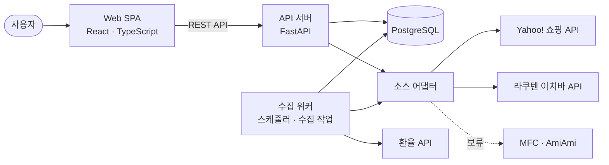

# FigureVault

피규어 컬렉션 관리 및 가격 추적 웹 플랫폼

| 항목 | 내용 |
| --- | --- |
| 문서 | 프로젝트 기획서 v0.1 (초안) |
| 단계 | 설계 단계. 구현 착수 전이며 실행 가능한 코드는 아직 없음 |
| 기준일 | 2026-11-19 (외부 API 관련 사실은 이 날짜 기준) |

## 1. 개요

FigureVault는 피규어 수집가가 보유·예약·관심 상품을 한곳에서 관리하고, 상품별 신품 판매가를 매일 기록해 가격 흐름을 확인하는 웹 서비스다.

쇼핑몰은 현재 가격만 보여주고 과거 가격은 보여주지 않는다. FigureVault는 판매가를 수집 시점별로 직접 쌓아 이 공백을 메우고, 사용자의 구매 기록과 연결해 컬렉션 전체의 지출과 가격 변동을 한 화면에서 보여준다.

제공 가치는 다음 세 가지다.

- **컬렉션 관리**: 무엇을, 언제, 얼마에 샀는지를 보유·예약·위시리스트로 나누어 기록
- **가격 이력**: 상품별 판매가를 일 단위로 축적하고 그래프로 제공
- **데이터 상태 공개**: 모든 가격에 수집 시각과 수집 상태를 함께 표시해, 사용자가 수치의 신뢰도를 직접 판단할 수 있게 함

## 2. 범위

### 2.1 목표

- 컬렉션에 등록된 상품의 신품 판매가를 일 1회 수집하고 이력으로 보존
- 구매 기록(금액·통화·구매일·구매처)과 가격 이력을 결합한 대시보드 제공
- 수집이 지연되거나 실패한 경우 그 사실을 화면에 그대로 노출

### 2.2 비목표

| 항목 | 사유 |
| --- | --- |
| 실시간 가격 제공 | 수집 주기는 일 1회이며, 그 이상의 실시간성은 보장하지 않음 |
| 중고 실거래 시세 제공 | 신품 판매가와 성격이 다른 데이터로, 초기 범위에서 제외 ([13. 향후 확장](#13-향후-확장) 참조) |
| 자산 가치 감정 | 평가금액은 참고용 추정치이며 실제 매각 가능 금액을 의미하지 않음 |
| 구매·결제·판매 중개 | 판매처로 연결되는 링크만 제공 |

## 3. 기능 요구사항

| ID | 기능 | 요약 | 단계 |
| --- | --- | --- | --- |
| F-01 | 피규어 검색·등록 | 카탈로그 검색, JAN 코드·키워드 기반 신규 등록, 상세 조회 | 1 |
| F-02 | 컬렉션 관리 | 보유·예약·위시리스트 구분, 구매 기록 관리 | 1 |
| F-03 | 가격 추적 | 일 1회 판매가 수집, 기간별 가격 그래프 | 1 |
| F-04 | 데이터 상태 표시 | 가격별 수집 시각·상태 표시 | 1 |
| F-05 | 대시보드 | 총 구매금액, 평가금액, 컬렉션 구성, 가격 변동 통계 | 2 |

### F-01 피규어 검색·등록

- 등록된 카탈로그를 상품명·작품명·캐릭터·제조사로 검색
- 카탈로그에 없는 상품은 JAN 코드 또는 키워드로 쇼핑몰 API를 조회하고, 사용자가 후보 중 하나를 선택하면 카탈로그에 등록
- 상세 화면에 기본 정보(작품, 캐릭터, 제조사, 발매일, 정가)와 가격 그래프 표시
- 쇼핑몰 응답으로 채워지지 않는 항목(작품명, 캐릭터 등)은 사용자가 직접 보정 가능

### F-02 컬렉션 관리

- 상태: 보유, 예약, 위시리스트. 상태 간 전환 지원 (예: 위시리스트 → 예약 → 보유)
- 구매 기록: 수량, 구매금액, 통화, 구매일, 구매처
- 동일 상품을 여러 번 구매한 경우 건별로 기록

### F-03 가격 추적

- 추적 대상은 한 명 이상의 사용자가 컬렉션에 등록한 상품으로 한정
- 쇼핑몰(소스)별로 판매가를 일 1회 수집해 저장
- 상품 상세에서 기간(1개월·6개월·전체)별 가격 그래프 제공

### F-04 데이터 상태 표시

- 가격이 노출되는 모든 화면에 마지막 수집 시각과 데이터 상태를 함께 표시
- 상태 정의는 [4.3 데이터 상태](#43-데이터-상태) 참조

### F-05 대시보드

- 총 구매금액, 평가금액(추정) 및 구매금액 대비 증감
- 컬렉션 구성: 상태별·제조사별·작품별 수량과 금액
- 가격 변동 통계: 기간 내 상승·하락 폭 상위 상품

## 4. 가격 데이터 정책

### 4.1 용어 정의

| 용어 | 정의 |
| --- | --- |
| 판매가 | 쇼핑몰에 표시된 신품의 세금 포함 가격. 배송비, 관부가세, 포인트 적립은 반영하지 않음 |
| 기준가 | 한 번의 수집에서 확인된 "판매 가능한 신품" 중 최저 판매가. 쇼핑몰(소스)별로 산출 |
| 최종 관측가 | 판매 가능한 신품이 없을 때 대신 표시하는, 마지막으로 관측된 기준가 |
| 평가금액 | 보유 수량 × 기준가(없으면 최종 관측가). 참고용 추정치 |

### 4.2 수집 기준

- **주기**: 일 1회 (목표)
- **대상**: 사용자 컬렉션에 등록된 상품. 전체 카탈로그를 수집하지 않음
- **식별**: JAN 코드(상품 바코드)를 기준으로 소스 간 동일 상품을 식별
- **저장**: 수집 시점별 스냅샷을 추가만 하고 수정·삭제하지 않음. 수집 시작 이전의 이력은 보유하지 않음
- **통화**: 수집한 통화 그대로 저장하고, 화면에서 환산할 때는 적용 환율의 기준일을 함께 표시

### 4.3 데이터 상태

| 상태 | 판정 기준 | 화면 표시 |
| --- | --- | --- |
| 정상 | 마지막 수집 성공 후 36시간 이내 | 기준가, 수집 시각 |
| 갱신 지연 | 마지막 수집 성공 후 36시간 초과 | 기준가, 수집 시각, "갱신 지연" 표시 |
| 판매처 없음 | 수집은 성공했으나 판매 가능한 신품이 없음 | 최종 관측가, 관측일, "판매처 없음" 표시 |
| 수집 실패 | 3회 연속 수집 실패 | 마지막으로 저장된 값, "수집 실패" 표시 |

판정 기준의 수치(36시간, 3회)는 초기값이며 운영 결과에 따라 조정한다.

### 4.4 한계 및 고지

- **실시간성**: 가격은 수집 시점의 값이며 현재 쇼핑몰 가격과 다를 수 있음
- **시세와의 구분**: 신품 판매가와 중고 실거래가는 별개이며, 현재 판매가를 실제 자산 가치로 간주하지 않음
- **통화·지역**: 가격 소스가 일본 쇼핑몰이므로 엔화 기준이며, 국내 판매가와 다를 수 있음
- **외부 의존**: 가격 수집은 외부 API에 의존하며, 제공사의 정책 변경이나 서비스 종료 시 해당 소스의 수집이 중단될 수 있음
- **평가금액**: 위 한계를 모두 포함한 참고용 추정치로만 표시

## 5. 데이터 소스

### 5.1 선정 원칙

1. **공식 API 우선**: 제공사가 문서화하고 이용 조건을 공개한 API를 1차 소스로 사용. 일 단위 이력이 핵심 자산이므로, 예고 없이 중단될 수 있는 비공식 경로에 수집을 의존하지 않음
2. **어댑터 격리**: 소스별 연동 코드를 공통 인터페이스 뒤에 분리해, 소스 추가·교체·중단이 나머지 시스템에 영향을 주지 않게 함
3. **JAN 코드 기준 식별**: 소스마다 다른 상품 ID 대신 JAN 코드로 동일 상품을 연결
4. **이용 조건 준수**: 소스별 호출 한도, 출처 표시, 데이터 보관 조건을 따름

### 5.2 소스별 채택 현황

| 소스 | 용도 | 접근 방식 | 상태 | 비고 |
| --- | --- | --- | --- | --- |
| Yahoo! 쇼핑 상품 검색 API (v3) | 가격, 상품 기본 정보 | 공식 API | 채택 | JAN 코드 검색 지원. 호출 한도 초당 1회 |
| 라쿠텐 이치바 상품 검색 API | 가격, 상품 기본 정보 | 공식 API | 채택 | 2026년에 개편된 엔드포인트·인증 방식 기준으로 연동 |
| MyFigureCollection | 카탈로그 보강 (작품, 캐릭터 등) | 공개 API 없음 | 보류 | 운영 정책 확인 후 결정. 기본 비활성 |
| AmiAmi | 가격 | 문서화된 공식 API 없음 | 보류 | 위와 같음 |
| 네이버 쇼핑 검색 API | 국내 판매가 | 공식 API | 제외 | 2026-07-31 서비스 종료, 대체 API 없음 |

호출량 기준으로 추적 상품 3,000건을 초당 1회 한도로 수집하면 소스당 약 50분이 걸리며, 일 1회 배치로 처리 가능한 규모다.

## 6. 시스템 구성

| 구성 요소 | 책임 |
| --- | --- |
| Web SPA | 검색, 컬렉션 관리, 가격 그래프, 대시보드 화면 |
| API 서버 | 인증, 컬렉션·카탈로그 조회 및 변경, 상품 등록 시 외부 검색 |
| 수집 워커 | 일 1회 가격 수집, 환율 갱신, 수집 실행 이력 기록 |
| 소스 어댑터 | 쇼핑몰별 API 호출, 응답 검증, 공통 형식으로 변환 |
| PostgreSQL | 카탈로그, 컬렉션, 가격 스냅샷, 수집 실행 이력 저장 |

수집 워커는 API 서버와 별도 프로세스로 실행해, 수집 장애가 조회 서비스에 영향을 주지 않게 한다.

## 7. 기술 스택

| 영역 | 선택 | 선정 근거 |
| --- | --- | --- |
| Frontend | React, TypeScript, Vite | 로그인 후 사용하는 화면이 중심이라 검색 엔진 노출을 위한 서버 렌더링이 필요 없음. 정적 배포 가능한 SPA로 충분 |
| 데이터 조회·차트 | TanStack Query, Recharts | 조회 중심 화면의 캐싱과 재요청 처리, 시계열 그래프 |
| Backend | Python, FastAPI | API와 수집 작업을 한 언어·한 코드베이스로 유지. Pydantic으로 외부 API 응답을 검증 |
| 데이터 접근 | SQLAlchemy, Alembic | 스키마 변경을 마이그레이션으로 이력 관리 |
| Database | PostgreSQL | 상품 3,000건·소스 2개 기준 가격 스냅샷은 연 약 220만 행으로, 단일 인스턴스로 충분하며 별도 시계열 DB가 필요 없음 |
| 수집·스케줄 | 전용 워커 프로세스, APScheduler | 일 1회 배치에는 메시지 큐(Celery·Redis)가 필요 없음. 실행 이력은 DB에 기록 |
| 외부 호출 | httpx | 타임아웃, 재시도, 요청 간격 제어 |
| 인증 | 이메일·비밀번호 계정(Argon2 해시), 세션 쿠키 | 소셜 로그인은 후속 단계에서 검토 |
| 실행 환경 | Docker Compose | web, api, worker, db를 동일 구성으로 실행 |
| 품질 관리 | pytest, Vitest, Ruff, ESLint, GitHub Actions | 테스트·정적 검사를 PR 단위로 자동 실행 |

## 8. 데이터 모델

| 엔터티 | 설명 | 주요 속성 |
| --- | --- | --- |
| users | 사용자 계정 | 이메일, 비밀번호 해시 |
| figures | 피규어 카탈로그 | JAN 코드(고유), 상품명, 작품, 캐릭터, 제조사, 발매일, 정가, 이미지 URL |
| collection_items | 사용자별 컬렉션 항목 | 사용자, 피규어, 상태, 수량, 구매금액, 통화, 구매일, 구매처 |
| price_snapshots | 수집 시점별 가격 | 피규어, 소스, 수집 시각, 기준가, 통화, 판매처 수, 판매 가능 여부 |
| collection_runs | 수집 실행 이력 | 소스, 시작·종료 시각, 성공·실패 건수, 오류 요약 |
| exchange_rates | 일별 환율 | 기준일, 통화 쌍, 환율 |

`price_snapshots`는 추가 전용이며, 데이터 상태(4.3)는 이 테이블과 `collection_runs`에서 계산한다. 상품 이미지는 파일을 저장하지 않고 원본 URL만 보관한다.

## 9. 비기능 요구사항

| 구분 | 요구사항 |
| --- | --- |
| 보안 | 비밀번호는 해시로만 저장. API 키는 환경 변수로 주입하고 저장소에 커밋하지 않음. 컬렉션 데이터는 본인만 조회·변경 가능 |
| 수집 안정성 | 실패한 요청은 간격을 늘려 재시도하고, 최종 실패는 실행 이력에 기록. 한 소스의 실패가 다른 소스의 수집을 막지 않음 |
| 이용 조건 준수 | 소스별 호출 한도 내에서 요청 간격을 유지하고, 제공사가 요구하는 출처 표시를 화면에 적용 |
| 운영 가시성 | 수집 실행별 성공·실패 건수와 소요 시간을 확인할 수 있는 운영 화면 또는 로그 제공 |

## 10. 로드맵

| 단계 | 범위 | 완료 기준 |
| --- | --- | --- |
| 0. 사전 검증 | API 키 발급, 이용 약관 확인, JAN 코드 조회 정확도 검증 | 샘플 상품 50건으로 기준가 산출 성공률을 측정하고 필터 규칙을 확정. [12. 미결 사항](#12-미결-사항)의 1·2번 해소 |
| 1. MVP | 계정, 피규어 등록, 컬렉션 관리, 일 1회 수집, 가격 그래프, 데이터 상태 표시 (F-01 ~ F-04) | 등록한 상품의 가격이 7일 연속 수집되고 그래프와 상태가 화면에 표시됨 |
| 2. 대시보드 | 대시보드, 환율 환산, 평가금액 (F-05) | 구매금액과 평가금액이 통화 환산되어 대시보드에 표시됨 |
| 3. 확장 | [13. 향후 확장](#13-향후-확장) 항목 중 우선순위에 따라 선정 | 항목별로 별도 정의 |

## 11. 리스크 및 대응

| 리스크 | 영향 | 대응 |
| --- | --- | --- |
| 외부 API의 정책 변경·종료 (예: 네이버 쇼핑 검색 API 2026-07-31 종료) | 해당 소스의 가격 수집 중단 | 소스 어댑터 격리, 2개 이상 소스 병행, 중단 시 데이터 상태로 사용자에게 고지 |
| 이용 약관상 수집 데이터의 장기 보관 제한 | 가격 이력 기능의 범위 축소 | 구현 전 약관 확인 (단계 0). 제한이 있으면 보관 범위와 소스 구성을 재설계 |
| JAN 코드 조회 결과에 다른 상품 혼입 (중고, 세트, 예약금 상품 등) | 기준가 왜곡 | 신품 조건 필터, 정가 대비 이상치 제외, 판매처 수를 함께 저장해 검증 |
| 쇼핑몰 응답만으로는 작품·캐릭터 정보가 부족 | 검색 품질 저하 | 사용자 보정 허용, 운영 정책 확인 후 MFC 보강 검토 |
| 호출 한도 초과 | 수집 지연 또는 차단 | 추적 대상을 컬렉션 등록 상품으로 한정, 요청 간격 유지 |

## 12. 미결 사항

| No. | 항목 | 결정 시점 |
| --- | --- | --- |
| 1 | Yahoo!·라쿠텐 API 이용 약관의 데이터 보관 기간, 출처 표시 의무 확인 | 단계 0 |
| 2 | 라쿠텐 개편 API의 세부 사양(인증, 응답 항목)을 공식 문서로 확인 | 단계 0 |
| 3 | MyFigureCollection, AmiAmi 데이터 활용 가능 여부 | 단계 1 종료 전 |
| 4 | 환율 소스 확정 (후보: 한국수출입은행 환율 API) | 단계 2 착수 전 |
| 5 | 배포 환경 확정 | 단계 1 종료 전 |

## 13. 향후 확장

- 가격 하락 및 재입고 알림
- 쇼핑몰별 가격 비교 화면
- 중고 실거래 시세 분석
- 이미지 기반 피규어 검색

## 14. 참고 자료

- [Yahoo!ショッピング 商品検索 API (v3)](https://developer.yahoo.co.jp/webapi/shopping/v3/itemsearch.html)
- [楽天ウェブサービス](https://webservice.rakuten.co.jp/)
- [네이버 검색 API 종료 및 NAVER API HUB 이관 정리](https://waffleboard.io/blog/naver-search-api-hub-migration-guide) (제3자 정리 글)

본 프로젝트는 위에 언급된 서비스 및 그 운영사와 제휴 관계가 없다.
