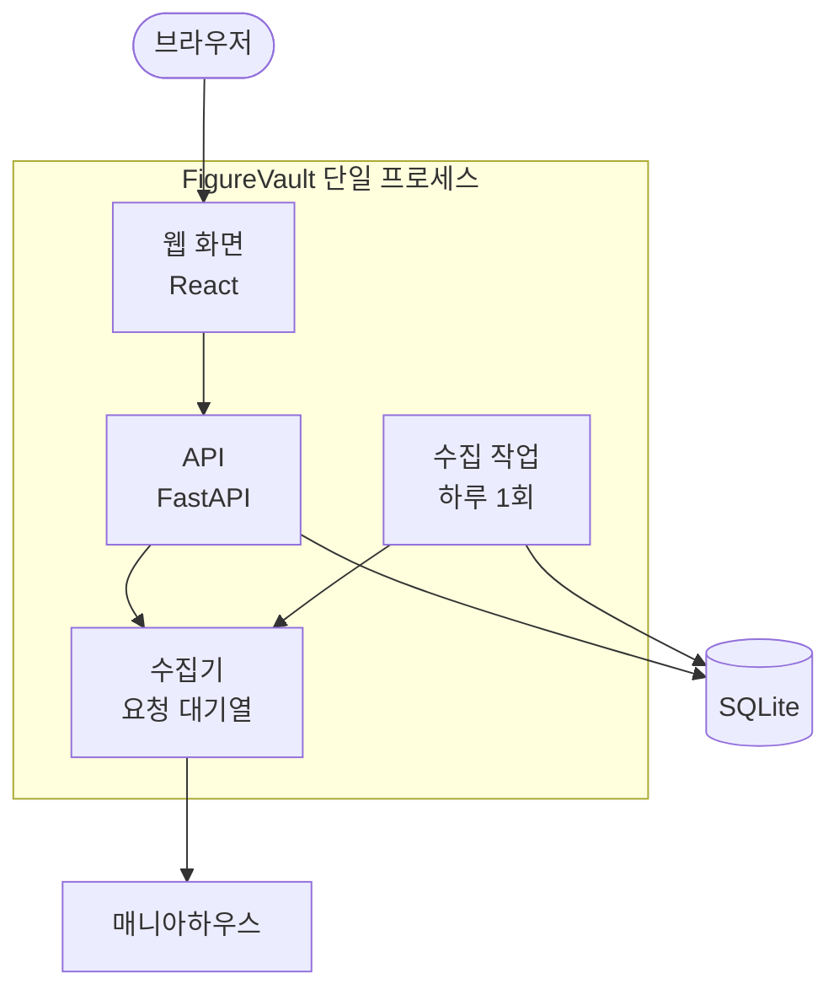

# FigureVault

매니아하우스의 피규어 판매가를 매일 기록하는 개인용 위시리스트·컬렉션 관리 도구

| 항목 | 내용 |
| --- | --- |
| 문서 | 프로젝트 기획서 v0.4 (구조 확정, 보안 설계 반영) |
| 단계 | 설계 완료. 구현 착수 전이며 실행 가능한 코드는 아직 없음 |
| 기준일 | 2026-11-26 |

## 1. 개요

FigureVault는 사고 싶은 피규어와 예약한 피규어의 판매가를 하루 한 번 기록해, 가격이 내렸는지와 품절됐는지를 한 화면에서 확인하는 개인용 도구다. 매니아하우스의 상품 주소를 붙여 넣으면 등록되고, 구매한 뒤에는 구매 기록으로 넘어가 지출 합계에 반영된다.

대상 샵은 매니아하우스 한 곳이고, 사용자는 본인 한 명이다. 초기 구상은 전체 카탈로그와 여러 쇼핑몰의 가격을 다루는 공개 서비스였으나, 그 범위를 뒷받침할 데이터 소스가 없어 범위를 줄였다. 조사 내용은 [research/data-sources/report.md](research/data-sources/report.md)에 있다.

## 2. 범위

### 2.1 하는 것

- 매니아하우스 상품 주소로 피규어 등록
- 위시리스트·예약·보유 상태 관리와 구매 기록
- 위시리스트·예약 상품의 판매가와 품절 여부를 하루 1회 수집
- 가격 그래프, 최저가, 등록 시점 대비 변동 표시
- 총 구매금액과 월별 지출 요약

### 2.2 하지 않는 것

- **공개 서비스와 수익화**: 한 사람이 자기 PC에서 쓰는 비영리 도구로 한정. [5.3 운영 전제](#53-운영-전제) 참조
- **다른 샵 지원과 가격 비교**: 대상은 매니아하우스 한 곳
- **전체 카탈로그와 상품 검색**: 등록한 상품만 다룸
- **일본 샵 가격과 환율 환산**: 주요 일본 샵이 자동 접근을 차단함
- **중고 시세와 평가금액**: 신품 판매가로는 보유품의 가치를 산정할 수 없음
- **알림**: [13. 이후 검토](#13-이후-검토) 항목

## 3. 기능 요구사항

| ID | 기능 | 요약 |
| --- | --- | --- |
| F-01 | 상품 등록 | 상품 주소를 붙여 넣어 등록 |
| F-02 | 상태·구매 기록 | 위시리스트·예약·보유, 구매금액 |
| F-03 | 가격 수집 | 하루 1회 판매가·품절 여부 기록 |
| F-04 | 가격 보기 | 목록의 가격 변동, 상세의 그래프 |
| F-05 | 지출 요약 | 총 구매금액, 월별 지출 |

### F-01 상품 등록

- 매니아하우스 상품 주소를 붙여 넣으면 상품명, 이미지 주소, 현재 판매가, 품절 여부를 가져와 등록
- 주소에서 상품 번호만 추출해 식별자로 사용. 같은 상품은 중복 등록되지 않음
- 매니아하우스 상품 주소 형식이 아니면 등록하지 않음. 검증 기준은 [9.1 외부 요청 통제](#91-외부-요청-통제) 참조
- 가격을 추적하는 상품은 최대 50개. 넘으면 기존 상품의 추적을 꺼야 새로 추적할 수 있음
- 가져온 상품명은 사용자가 수정 가능

### F-02 상태·구매 기록

- 상태: 위시리스트, 예약, 보유
- 구매 기록: 구매금액, 구매일
- 보유로 바꾸면 가격 추적을 중지. 필요하면 상품별로 다시 켤 수 있음

### F-03 가격 수집

- 추적 중인 상품의 판매가와 품절 여부를 하루 1회 수집해 저장
- 수동 새로고침 기능은 두지 않음
- PC가 꺼져 있어 수집하지 못한 날은 비워 두고, 다음 실행 때 1회 수집
- 수집 규칙은 [5.2 수집 규칙](#52-수집-규칙) 참조

### F-04 가격 보기

- 목록: 현재가, 기록된 최저가, 등록 시점 대비 변동, 품절 여부, 마지막 수집 시각
- 상세: 기간별 가격 그래프, 매니아하우스 상품 페이지로 가는 링크

### F-05 지출 요약

- 총 구매금액과 보유 수량
- 월별 구매금액

## 4. 가격 데이터 기준

- **판매가**: 매니아하우스 상품 페이지에 표시된 원화 판매가. 배송비, 적립금, 쿠폰 할인은 반영하지 않음
- **이력**: 수집 시점별 값을 추가만 하고 수정·삭제하지 않음. 등록 이전의 가격은 보유하지 않음
- **한계**: 하루 1회 수집한 값이므로 현재 샵 가격과 다를 수 있음. 한 샵의 가격이며 시세나 자산 가치를 의미하지 않음

| 상태 | 판정 기준 |
| --- | --- |
| 정상 | 마지막 수집 성공 후 36시간 이내 |
| 갱신 지연 | 마지막 수집 성공 후 36시간 초과 |
| 품절 | 수집은 성공했으나 샵에서 품절로 표시 |
| 수집 실패 | 3회 연속 수집 실패 |
| 수집 중지 | 샵의 거절 응답으로 수집을 멈춘 상태 |

품절 상태에서는 마지막으로 기록된 판매가를 함께 표시한다.

## 5. 수집 방식

### 5.1 수집 대상

- 대상은 사용자가 등록한 매니아하우스 상품 상세 페이지뿐이다. 목록, 검색, 게시판, 회원 영역은 요청하지 않는다
- 상품 페이지의 메타 정보에 원화 판매가와 재고 상태가 들어 있어, 화면 구조에 의존하지 않고 읽는다
- 이미지, 스크립트, 스타일 파일은 받지 않는다. 상품 한 건의 수집은 요청 한 번이다

### 5.2 수집 규칙

| 항목 | 기준 |
| --- | --- |
| 추적 상품 수 | 최대 50개 |
| 수집 주기 | 상품당 하루 1회 |
| 하루 요청 상한 | 100회 (등록 포함) |
| 요청 간격 | 10초 이상, 한 번에 한 건 |
| 수집 시각 | 새벽 4시. 꺼져 있었으면 다음 실행 때 |
| 재시도 | 네트워크 오류에 한해 상품당 1회 |

- 요청 간격 10초는 샵의 robots.txt에 적힌 `Crawl-delay: 10`을 따른 값이다
- 등록과 수집의 모든 요청은 하나의 대기열을 거쳐, 어떤 경우에도 위 간격과 상한을 넘지 않는다
- 도구를 식별할 수 있는 User-Agent를 쓴다. 브라우저로 위장하지 않는다
- 로그인, 쿠키 유지, 프록시, 동시 요청을 쓰지 않는다
- 저장하는 것은 판매가, 품절 여부, 상품명, 이미지 주소다. 이미지 파일은 저장하지 않고 원본 주소로 표시한다

거절 응답에 대한 처리는 다음과 같다.

- 403, 429, 503 응답을 받으면 그날의 수집을 즉시 멈춘다
- 다음 날 한 번 다시 시도하고, 3일 연속 거절되면 수집을 중지 상태로 바꾼다
- 중지 상태는 사용자가 직접 풀기 전까지 유지한다. 차단을 우회하는 수단은 넣지 않는다

상한까지 써도 하루 100회, 약 17분에 걸친 요청이다. 사람 한 명이 같은 상품들을 브라우저로 한 번씩 열어 보는 것보다 샵에 주는 부하가 작다.

### 5.3 운영 전제

2026-11-26에 매니아하우스의 robots.txt와 이용약관을 확인했다.

- **robots.txt**: 모든 수집기에 대한 금지 경로는 관리자, 회원, 주문, 게시판 영역이고 상품 페이지는 포함되지 않는다
- **이용약관**: 자동 수집이나 프로그램 접근을 다루는 조항은 없다. 제22조가 샵에 지적재산권이 있는 정보를 사전 승낙 없이 영리 목적으로 이용하거나 제3자에게 이용하게 하는 것을 금지한다

이에 따라 다음을 전제로 한다.

- 본인만 사용한다. 수집한 가격과 상품 정보를 공개하거나 다른 사람에게 제공하지 않는다
- 영리 목적으로 쓰지 않는다
- 약관에 금지 조항이 없다는 것이 허용을 뜻하지는 않는다. 샵이 거절 의사를 보이면 수집을 멈춘다

## 6. 시스템 구성

한 프로세스가 화면 제공, API, 수집 작업을 모두 맡는다. 샵으로 나가는 요청은 수집기 하나만 보내며, 간격과 상한을 여기서 강제한다. 데이터는 SQLite 파일 하나에 저장한다.

## 7. 기술 스택

| 영역 | 선택 | 선정 근거 |
| --- | --- | --- |
| 화면 | React, TypeScript, Vite, Recharts | 목록과 그래프 중심의 작은 화면 |
| 서버 | Python, FastAPI | 수집과 API를 한 코드베이스로 유지 |
| 저장 | SQLite, SQLAlchemy, Alembic | 단일 사용자. 파일 하나로 백업 |
| 수집 | httpx, BeautifulSoup, APScheduler | 하루 1회, 최대 50건 규모 |
| 품질 | pytest, Ruff, pip-audit | 저장해 둔 상품 페이지로 수집 코드 검증, 의존성 취약점 점검 |

별도 DB 서버, 작업 큐, 컨테이너 구성은 두지 않는다. 명령 하나로 로컬에서 실행하는 것을 목표로 한다.

## 8. 데이터 모델

| 엔터티 | 주요 속성 |
| --- | --- |
| items | 상품 번호(고유), 상품명, 이미지 주소, 상태, 추적 여부, 구매금액, 구매일, 마지막 수집 성공 시각, 연속 실패 횟수 |
| price_snapshots | 상품, 수집 시각, 판매가, 품절 여부 |
| fetch_log | 요청 시각, 응답 코드 |

`price_snapshots`는 추가 전용이다. 데이터 상태(4장)는 `items`의 마지막 수집 성공 시각과 연속 실패 횟수로 계산한다. `fetch_log`는 하루 요청 상한과 거절 응답 횟수를 세는 데 쓴다.

## 9. 보안 설계

로그인이 없는 로컬 단일 사용자 도구라는 전제에서, 지켜야 할 것은 세 가지다.

1. 이 도구가 매니아하우스 외의 주소로 요청을 보내는 통로가 되지 않을 것
2. 샵에서 가져온 내용이 사용자의 브라우저나 PC에서 코드로 실행되지 않을 것
3. 구매 기록이 PC 밖으로 나가지 않을 것

### 9.1 외부 요청 통제

사용자가 붙여 넣은 주소를 서버가 그대로 요청하면, 내부망 주소나 임의의 사이트로 요청을 보내게 만들 수 있다. 이를 막기 위해 입력한 주소는 요청에 쓰지 않는다.

- 입력한 주소에서 상품 번호(숫자)만 추출하고, 요청할 주소는 서버가 고정된 형식으로 직접 만든다
- 추출 전에 주소를 검증한다. 프로토콜은 `https`, 호스트는 `maniahouse.co.kr`과 정확히 일치, 포트와 계정 정보가 없을 것
- 리다이렉트는 따라가지 않는다. 3xx 응답은 수집 실패로 기록한다
- 인증서 검증을 끄지 않는다
- 요청마다 제한 시간 15초, 응답 크기 2MB 상한을 둔다
- 샵으로 나가는 요청 코드는 수집기 한 곳에만 둔다. 다른 코드가 외부 요청을 직접 보내지 않는다

### 9.2 로컬 서버 보호

로컬에서 도는 서버도 사용자가 방문한 다른 웹사이트의 공격 대상이 될 수 있다. 악성 페이지가 브라우저를 통해 로컬 API를 호출하면 데이터 삭제나 요청 남발을 일으킬 수 있다.

- 서버는 `127.0.0.1`에만 연결한다. 같은 네트워크의 다른 기기에서 접근할 수 없다
- `Host` 헤더가 `127.0.0.1` 또는 `localhost`가 아니면 거절한다
- 데이터를 바꾸는 요청은 `Origin` 헤더가 이 도구의 주소일 때만 받는다
- 다른 출처를 허용하는 CORS 설정을 두지 않는다
- API 입력은 형식과 범위를 검증한다. 금액은 0 이상의 정수, 문자열은 길이 상한

### 9.3 가져온 데이터 처리

상품명과 이미지 주소는 외부에서 온 값이므로 신뢰하지 않는다.

- 상품명은 텍스트로만 표시한다. 화면에 HTML로 삽입하는 기능을 쓰지 않는다
- 이미지 주소는 `https`이고 매니아하우스 도메인일 때만 저장한다. 그 외에는 이미지 없이 등록한다
- 콘텐츠 보안 정책(CSP)으로 스크립트는 자체 파일만, 이미지는 자체 파일과 매니아하우스만 허용한다
- 이미지를 불러올 때 리퍼러를 보내지 않는다
- 판매가는 정수로 변환되고 1원 이상 1,000만 원 이하일 때만 저장한다. 벗어나면 수집 실패로 기록한다
- 가져온 값은 파싱만 하고 실행하지 않는다. DB 접근은 값 바인딩만 쓰고 문자열로 SQL을 조립하지 않는다

### 9.4 저장 데이터와 비밀 정보

- 샵 계정, 비밀번호, 결제 정보를 다루지 않는다. 도구에 저장할 비밀 정보가 없다
- DB 파일에는 구매 기록이 들어 있다. 저장소 밖의 사용자 데이터 폴더에 두고, `.gitignore`로 DB 파일과 환경 설정 파일의 커밋을 막는다
- 매니아하우스 외의 외부 서비스로 데이터를 보내지 않는다. 사용 통계 수집이나 외부 로그 전송을 넣지 않는다
- User-Agent에는 도구 이름과 버전만 넣고 개인 정보를 넣지 않는다
- 오류 화면에 내부 경로나 스택 정보를 노출하지 않는다

### 9.5 의존성 관리

- 파이썬과 프런트엔드 의존성은 잠금 파일로 버전을 고정한다
- GitHub Actions에서 의존성 취약점 점검(`pip-audit`, `npm audit`)을 실행한다
- 의존성 수를 최소로 유지한다

### 9.6 범위 밖

이 설계는 로컬 실행만 전제로 한다. 서버에 올리거나 외부에서 접속하게 하려면 로그인, 전송 구간 암호화, 접근 제한을 새로 설계해야 하며, 그 전에는 네트워크에 공개하지 않는다.

## 10. 로드맵

### 단계 1. 등록과 목록

- **범위**: 수집기(주소 검증, 요청 대기열, 간격·상한), 로컬 서버 보호 설정, 상품 등록, 상태 변경, 목록 화면 (F-01, F-02)
- **완료 기준**: 상품 주소를 붙여 넣으면 상품명·가격·품절 여부가 채워져 목록에 표시되고, 주소 검증과 요청 간격·상한이 테스트로 검증됨

### 단계 2. 가격 수집과 그래프

- **범위**: 하루 1회 수집, 거절 응답 처리, 데이터 상태 표시, 가격 그래프 (F-03, F-04)
- **완료 기준**: 등록한 상품의 가격이 7일 연속 기록되고 그래프와 상태가 표시됨

### 단계 3. 지출 요약

- **범위**: 구매 기록, 총액과 월별 지출 (F-05)
- **완료 기준**: 보유로 바꾼 상품의 구매금액이 요약 화면에 합산됨

## 11. 리스크 및 대응

- **샵 페이지 구조 변경**: 수집이 실패하거나 잘못된 값을 읽을 수 있음. 저장해 둔 상품 페이지로 수집 코드를 테스트하고, 값을 읽지 못하면 추정하지 않고 수집 실패로 기록
- **샵의 접근 차단 또는 정책 변경**: 수집이 중단됨. 우회하지 않고 수집 중지 상태로 알리며, 그동안의 기록은 그대로 유지
- **단일 샵 의존**: 매니아하우스에 없는 상품은 등록할 수 없고, 샵이 수집을 막으면 가격 추적 전체가 멈춤. 컬렉션과 구매 기록 기능은 수집과 무관하게 동작하도록 분리
- **수집 공백**: PC가 꺼져 있으면 그날의 가격이 비게 됨. 빈 날은 채우지 않고 그래프에 공백으로 표시

## 12. 미결 사항

| No. | 항목 | 결정 시점 |
| --- | --- | --- |
| 1 | 예약 상품의 예약금·잔금 표시 방식 처리 | 단계 1 |
| 2 | 옵션이 있는 상품의 가격 처리 | 단계 1 |

## 13. 이후 검토

- 가격 하락·재입고 알림
- 예약 상품의 발매 예정월과 월별 결제 예정액 관리
- 다른 샵 추가. 피규어프레소와 히어로타임은 상품 페이지가 일반 요청에 404로 응답해 원인 확인이 필요

## 14. 참고

- [데이터 확보 방안 조사 보고서](research/data-sources/report.md)

본 프로젝트는 매니아하우스 및 위에 언급된 서비스와 제휴 관계가 없다.
